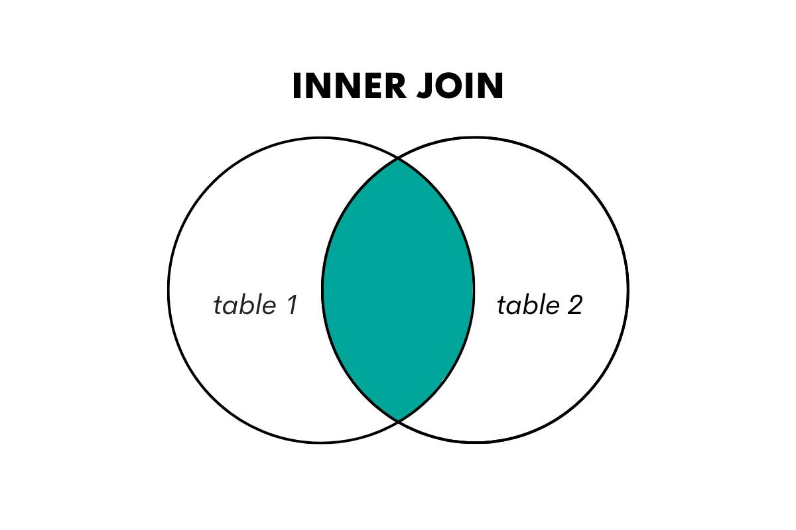
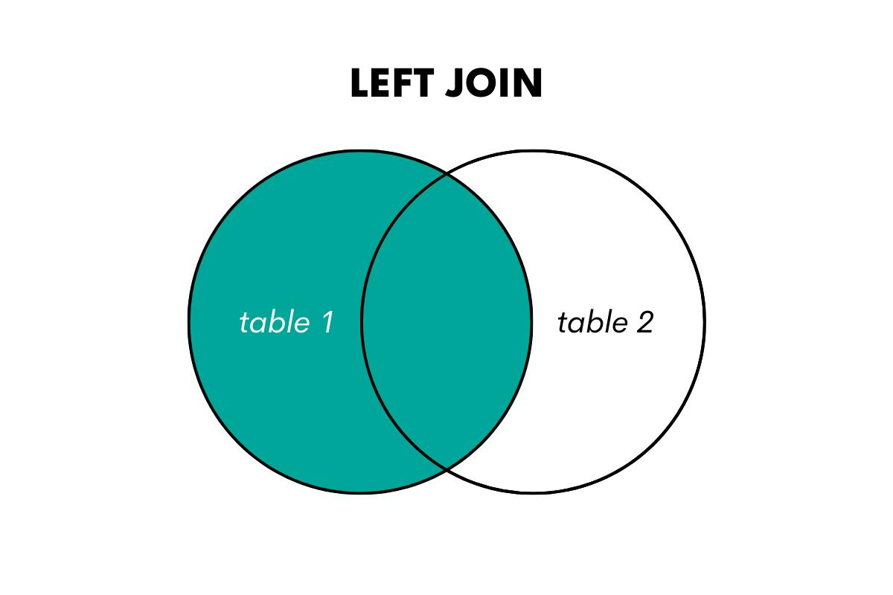
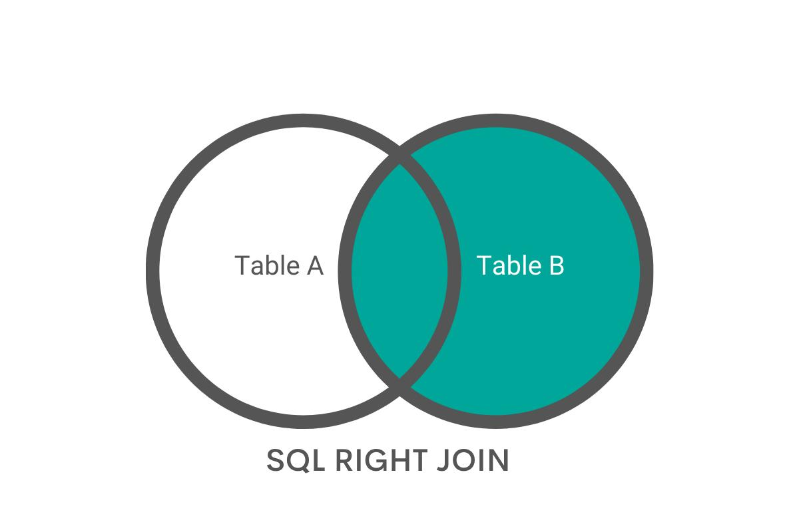
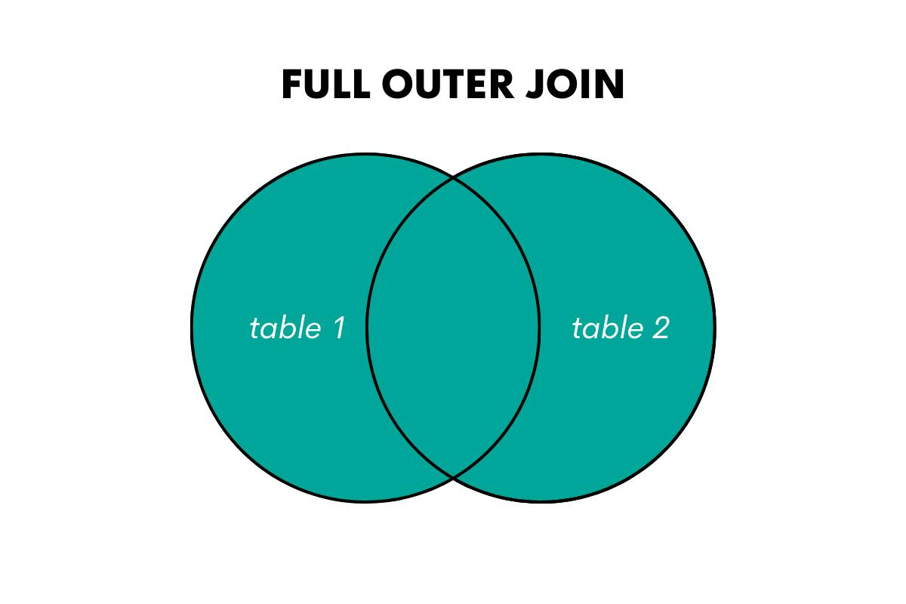

# JOIN

```SQL
*
DROP TABLE Przedmioty;
DROP TABLE Osoby;
*/
CREATE TABLE Osoby (
 osoba_id INT AUTO_INCREMENT PRIMARY KEY,
 imie VARCHAR(50) NOT NULL,
 nazwisko VARCHAR(50) NOT NULL
);
CREATE TABLE Przedmioty (
 przedmiot_id INT AUTO_INCREMENT PRIMARY KEY,
 nazwa VARCHAR(100) NOT NULL,
 osoba_id INT,
 CONSTRAINT fk_przedmiot_osoba FOREIGN KEY (osoba_id)
REFERENCES Osoby(osoba_id)
);
INSERT INTO Osoby (imie, nazwisko) VALUES
('Jan', 'Kowalski'),
('Anna', 'Nowak'),
('Piotr', 'Zieliński'),
('Kasia', 'Wiśniewska'),
('Patryk', 'Nowakowski');
INSERT INTO Przedmioty (nazwa, osoba_id) VALUES
('Laptop', 1),
('Telefon', 1),
('Rower', 2),
('Książka', 3),
('Plecak', 4),
('Kubek', null);
```

> 💡 **Ważne:** `Patryk Nowakowski` nie ma przypisanego przedmiotu, a `Kubek` nie ma przypisanej osoby (`osoba_id = NULL`). To właśnie te rekordy pomagają zrozumieć różnice między rodzajami JOIN.


## INNER JOIN  

**INNER JOIN** — wszystkie wspólne rekordy, bez niedopasowanych rekordów ( bez `NULL`).



```SQL
select Osoby.imie, Osoby.nazwisko, Przedmioty.nazwa
from Osoby
inner join Przedmioty on Osoby.osoba_id = Przedmioty.osoba_id;
```


**Wynik:**

| imie  | nazwisko   | nazwa   |
|-------|------------|---------|
| Jan   | Kowalski   | Laptop  |
| Jan   | Kowalski   | Telefon |
| Anna  | Nowak      | Rower   |
| Piotr | Zieliński  | Książka |
| Kasia | Wiśniewska | Plecak  |


## LEFT JOIN

**LEFT JOIN** — wszystkie rekordy z lewej tabeli. W tym przykładzie lewa tabela to **`Osoby`**. Jeśli osoba istnieje, ale nie ma dopasowania w tabeli `Przedmioty`, również zostanie wyświetlona.



```sql
SELECT Osoby.imie, Osoby.nazwisko, Przedmioty.nazwa
FROM Osoby
LEFT JOIN Przedmioty ON Osoby.osoba_id = Przedmioty.osoba_id;
```

**Wynik:**

| imie       | nazwisko       | nazwa      |
|------------|----------------|------------|
| Jan        | Kowalski       | Laptop     |
| Jan        | Kowalski       | Telefon    |
| Anna       | Nowak          | Rower      |
| Piotr      | Zieliński      | Książka    |
| Kasia      | Wiśniewska     | Plecak     |
| **Patryk** | **Nowakowski** | **`NULL`** |


## RIGHT JOIN

**RIGHT JOIN** — wszystkie rekordy z prawej tabeli. W tym przykładzie prawa tabela to **`Przedmioty`**. Jeśli przedmiot istnieje, ale nie ma dopasowania w tabeli `Osoby`, również zostanie wyświetlony.



```sql
SELECT Osoby.imie, Osoby.nazwisko, Przedmioty.nazwa
FROM Osoby
RIGHT JOIN Przedmioty ON Osoby.osoba_id = Przedmioty.osoba_id;
```

**Wynik:**

| imie       | nazwisko       | nazwa      |
|------------|----------------|------------|
| Jan        | Kowalski       | Laptop     |
| Jan        | Kowalski       | Telefon    |
| Anna       | Nowak          | Rower      |
| Piotr      | Zieliński      | Książka    |
| Kasia      | Wiśniewska     | Plecak     |
| **`NULL`** | **`NULL`**     | **Kubek**  |


## FULL OUTER JOIN

**FULL OUTER JOIN** — wszystkie rekordy z lewej i prawej tabeli połączone. W MySQL nie ma bezpośredniej instrukcji `FULL OUTER JOIN`, ale taki wynik można uzyskać przez połączenie `LEFT JOIN`, `RIGHT JOIN` i `UNION`.



```sql
SELECT o.imie, o.nazwisko, p.nazwa
FROM Osoby o
LEFT JOIN Przedmioty p ON o.osoba_id = p.osoba_id

UNION

SELECT o.imie, o.nazwisko, p.nazwa
FROM Osoby o
RIGHT JOIN Przedmioty p ON o.osoba_id = p.osoba_id;
```

**Wynik:**

| imie       | nazwisko       | nazwa      |
|------------|----------------|------------|
| Jan        | Kowalski       | Laptop     |
| Jan        | Kowalski       | Telefon    |
| Anna       | Nowak          | Rower      |
| Piotr      | Zieliński      | Książka    |
| Kasia      | Wiśniewska     | Plecak     |
| **Patryk** | **Nowakowski** | **`NULL`** |
| **`NULL`** | **`NULL`**     | **Kubek**  |


## 6. 🔀 CROSS JOIN (strony 23–24)

**CROSS JOIN** — łączy **każdy wiersz pierwszej tabeli z każdym wierszem drugiej tabeli** (iloczyn kartezjański).

> 🟪 **Schemat zamiast kół:** **5 osób × 6 przedmiotów = 30 kombinacji**. W przeciwieństwie do innych JOIN tutaj powstają wszystkie możliwe pary, niezależnie od wartości kluczy obcych.

```sql
SELECT o.imie, p.nazwa
FROM Osoby o
CROSS JOIN Przedmioty p;
```

**Wynik (wszystkie 30 wierszy):**

| imie   | nazwa   |
|--------|---------|
| Jan    | Laptop  |
| Anna   | Laptop  |
| Piotr  | Laptop  |
| Kasia  | Laptop  |
| Patryk | Laptop  |
| Jan    | Telefon |
| Anna   | Telefon |
| Piotr  | Telefon |
| Kasia  | Telefon |
| Patryk | Telefon |
| Jan    | Rower   |
| Anna   | Rower   |
| Piotr  | Rower   |
| Kasia  | Rower   |
| Patryk | Rower   |
| Jan    | Książka |
| Anna   | Książka |
| Piotr  | Książka |
| Kasia  | Książka |
| Patryk | Książka |
| Jan    | Plecak  |
| Anna   | Plecak  |
| Piotr  | Plecak  |
| Kasia  | Plecak  |
| Patryk | Plecak  |
| Jan    | Kubek   |
| Anna   | Kubek   |
| Piotr  | Kubek   |
| Kasia  | Kubek   |
| Patryk | Kubek   |


## LEFT JOIN excluding INNER JOIN 

**LEFT JOIN wykluczający wiersze dopasowane** — najpierw wykonuje `LEFT JOIN`, a następnie filtruje wynik, wyświetlając tylko rekordy **z lewej tabeli, które nie mają dopasowania w prawej**. W tym przykładzie są to osoby bez przedmiotów.
 
```sql
SELECT o.imie, o.nazwisko, p.nazwa
FROM Osoby o
LEFT JOIN Przedmioty p ON o.osoba_id = p.osoba_id
WHERE p.osoba_id IS NULL;
```

**Wynik:**

| imie       | nazwisko       | nazwa      |
|------------|----------------|------------|
| **Patryk** | **Nowakowski** | **`NULL`** |


## RIGHT JOIN excluding INNER JOIN 

**RIGHT JOIN wykluczający wiersze dopasowane** — najpierw wykonuje `RIGHT JOIN`, a następnie filtruje wynik, wyświetlając tylko rekordy **z prawej tabeli, które nie mają dopasowania w lewej**. W tym przykładzie jest to przedmiot bez przypisanej osoby.
 
```sql
SELECT o.imie, o.nazwisko, p.nazwa
FROM Osoby o
RIGHT JOIN Przedmioty p ON o.osoba_id = p.osoba_id
WHERE o.osoba_id IS NULL;
```

**Wynik:**

| imie       | nazwisko   | nazwa     |
|------------|------------|-----------|
| **`NULL`** | **`NULL`** | **Kubek** |


## 9. 🟦🟧 FULL OUTER JOIN excluding INNER JOIN (strony 27–28)

**FULL OUTER JOIN wykluczający rekordy wspólne** — łączy niedopasowane rekordy z lewej i prawej tabeli, a pomija rekordy, które mają dopasowanie w obu tabelach. W MySQL stosujemy w tym celu `UNION` dwóch odpowiednio filtrowanych zapytań.

 

```sql
SELECT o.imie, o.nazwisko, p.nazwa
FROM Osoby o
LEFT JOIN Przedmioty p ON o.osoba_id = p.osoba_id
WHERE p.osoba_id IS NULL

UNION

SELECT o.imie, o.nazwisko, p.nazwa
FROM Osoby o
RIGHT JOIN Przedmioty p ON o.osoba_id = p.osoba_id
WHERE o.osoba_id IS NULL;
```

**Wynik:**

| imie       | nazwisko        | nazwa      |
|------------|-----------------|------------|
| **Patryk** | **Nowakowski**  | **`NULL`** |
| **`NULL`** | **`NULL`**      | **Kubek**  |

